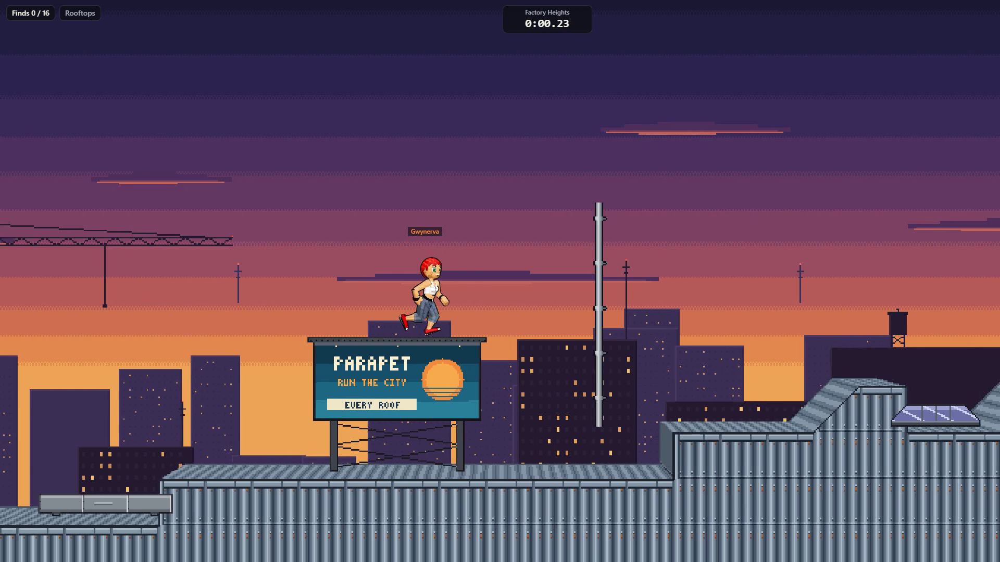
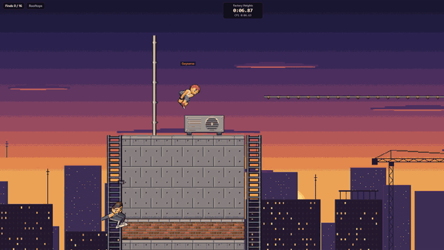
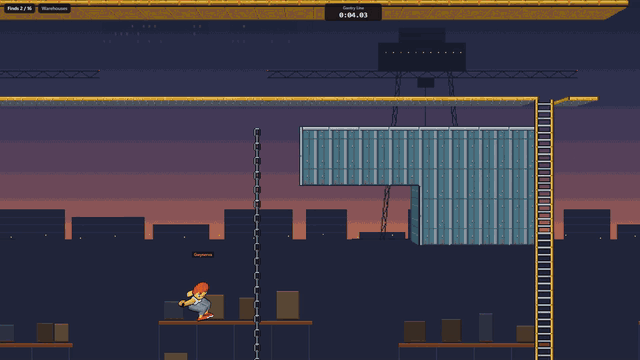
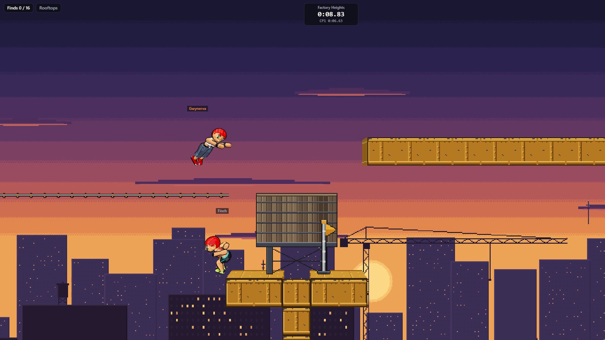
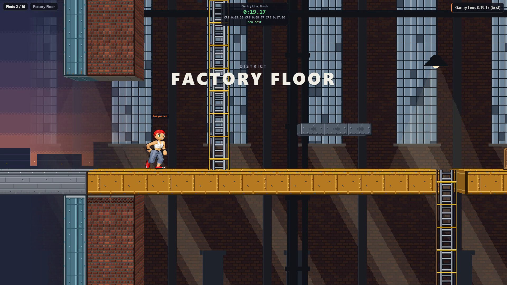
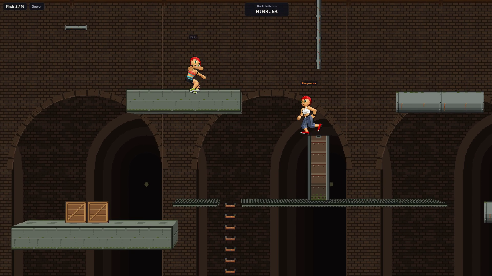

# Parapet

A parkour game set in one big, shared city: players run across connected rooftops, reach the
start gates of runs to race them, see each other all the time and leave their best lines behind
as ghosts.

**Status:** the MVP is playable: one seamless city of four districts (rooftops, warehouses, a
factory floor and a sewer), a server that simulates every runner, bots on looped routes, 16 time
trials, 16 hidden finds and four costumes. [`VISION.md`](VISION.md) collects the design directions,
[`docs/MVP-PLAN.md`](docs/MVP-PLAN.md) plans the first playable product, and
[`LESSONS-FROM-CLASSIC.md`](LESSONS-FROM-CLASSIC.md) records what to learn from the remake that
came first.



<p>
  
  
</p>

<p>
  
  
  
</p>

The flat tile city is drawn as a shallow slab in perspective, the runners are low-poly 3D over
pixel art, and everyone else in view is a bot simulated exactly like a player. Captured from the
game at 1920 x 1080 with the scripted lines the route checks find.

## Running it

Node 24 or later.

```sh
npm install
npm run bake      # rooms, art, clips, skins -> packages/content/dist
npm run serve     # the game server on http://localhost:8080 (WebSocket /ws)
npm run dev       # the game with hot reload on http://localhost:5180, proxying /ws to the server
```

`npm run build` builds the game into `packages/game/dist`, which `npm run serve` then serves too.
`npm run check` runs prettier, the package boundary check, the type checks and the tests;
`npm run check:bots` replays every bot route against the baked world; `npm run check:public`
refuses a build that still contains the clips lifted from Classic.

| Package    | What it is                                                                                        |
| ---------- | ------------------------------------------------------------------------------------------------- |
| `schemas`  | Data formats and constants shared by everything (units, cells, chunks, world, rig, skins, clips). |
| `sim`      | The deterministic integer simulation of runners, shared by browser and server.                    |
| `protocol` | Wire messages: binary codecs for the hot path, validated JSON for the rest.                       |
| `net`      | The client netcode as pure state machines (clock, prediction, remote runners).                    |
| `runtime`  | The WebGL renderer, input and audio.                                                              |
| `game`     | The game app: screens, HUD, menus.                                                                |
| `server`   | The game server: simulation of every runner, relay, bots, profiles, leaderboards.                 |
| `tools`    | The baker, art generators and checks.                                                             |
| `content`  | Rooms, palette, props, art, clips, skins, bot routes; `dist/` is the baked output.                |

## Relation to Parapet Classic

Parapet Classic is a separate, finished project: a faithful browser remake of the 2007 J2ME
game _Playman Extreme Running_, kept as a preservation project. Its mechanics, graphics, levels
and music come from someone else's game.

This project is our own game. It shares no code with Parapet Classic: it learns from how Classic
is built (architecture, techniques, tooling) and designs and draws everything else itself, from
the move set to the city.

One exception is recorded on purpose: for the MVP, the runner's animation clips are lifted from
Classic's keyframes onto our own 3D rig. Classic's keyframes come from someone else's game
(_Playman Extreme Running_), so these clips are not ours to ship: they are a temporary stand-in in
their own folder (`packages/content/clips/classic`), and a public build of the game refuses to
include them. The owner made this repository public with them on 2026-10-19. They are to be
replaced by our own or licensed clips (see [`docs/MVP-PLAN.md`](docs/MVP-PLAN.md), section 8).
